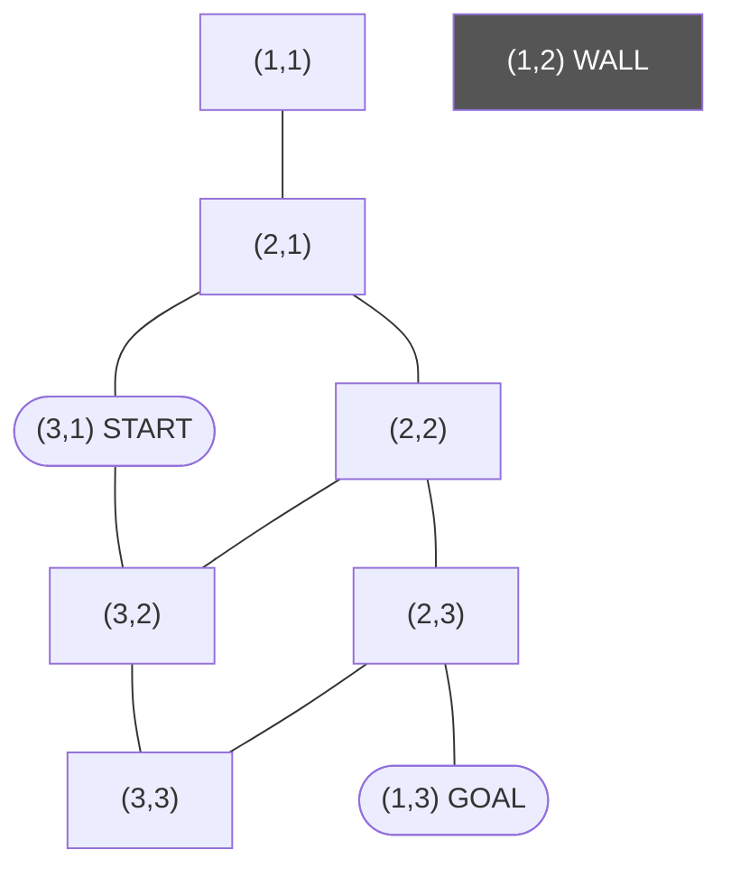

# Q1 — Uninformed vs. Informed Search on a Grid

> Topics: state-space search, BFS, DFS, completeness and optimality · Handnote pp. 1–6

## Question

*What is the difference between uninformed and informed state-space search?* A 3×3 grid world: start at the bottom-left cell (3,1), goal at the top-right cell (1,3), and cell (1,2) is a wall. Moves (up, down, left, right) cost 1.

1. Represent the problem as a state-space graph over the 8 reachable cells, and mark the start and goal.
2. Trace BFS step by step (frontier and explored set after each expansion) until the goal is found. State the path and its length.
3. Trace DFS (tie-break Up > Right > Down > Left). Does it find the same path? Explain why BFS is complete and optimal for unit costs, while DFS is complete only on finite graphs.

Rows are numbered from the top and columns from the left. 9 cells − 1 wall = **8 states**.

---

## Uninformed vs. informed search

- **Uninformed search** (BFS, DFS, UCS) uses only the problem definition: states, actions and costs.
- **Informed search** (Greedy best-first, A*) also uses a **heuristic** h(n) that estimates the cost from n to the goal, so it usually expands far fewer nodes.

For this grid, a natural heuristic is the Manhattan distance to the goal, `h(r, c) = |r − 1| + |c − 3|`. It never overestimates, since a wall can only make the real path longer, so it is admissible (and also consistent).

| Cell | (3,1) | (3,2) | (3,3) | (2,1) | (2,2) | (2,3) | (1,1) | (1,3) |
|---|---|---|---|---|---|---|---|---|
| h | 4 | 3 | 2 | 3 | 2 | 1 | 2 | 0 |

| | BFS | DFS | Greedy best-first | A* |
|---|---|---|---|---|
| Uses h? | No | No | Yes (f = h) | Yes (f = g + h) |
| Frontier | FIFO queue | LIFO stack | Priority queue by h | Priority queue by g + h |
| Complete? | Yes (finite b) | Only on finite graphs with duplicate check | Yes on finite graphs (graph search) | Yes (positive costs) |
| Optimal? | Yes, for unit costs only | No | No | Yes, if h is admissible |

---

## (i) State-space graph

| State | Position | Neighbours (in the order Up, Right, Down, Left) |
|---|---|---|
| (3,1) | START, bottom-left | Up → (2,1), Right → (3,2) |
| (3,2) | bottom-middle | Up → (2,2), Right → (3,3), Left → (3,1) |
| (3,3) | bottom-right | Up → (2,3), Left → (3,2) |
| (2,1) | middle-left | Up → (1,1), Right → (2,2), Down → (3,1) |
| (2,2) | centre | Right → (2,3), Down → (3,2), Left → (2,1) (Up is the wall) |
| (2,3) | middle-right | Up → (1,3), Down → (3,3), Left → (2,2) |
| (1,1) | top-left | Down → (2,1) only: a dead end |
| (1,3) | GOAL, top-right | Down → (2,3) only |

There are **9 undirected edges** (18 directed moves): (1,1)–(2,1), (2,1)–(3,1), (2,1)–(2,2), (2,2)–(2,3), (2,2)–(3,2), (2,3)–(1,3), (2,3)–(3,3), (3,1)–(3,2), (3,2)–(3,3).

## (ii) BFS trace

FIFO queue; neighbours added in the order Up, Right, Down, Left; goal test when a node is expanded.

| Step | Expand | Frontier after (front → back) | Explored |
|---:|---|---|---|
| 0 | — | [(3,1)] | { } |
| 1 | (3,1) | [(2,1), (3,2)] | {(3,1)} |
| 2 | (2,1) | [(3,2), (1,1), (2,2)] | + (2,1) |
| 3 | (3,2) | [(1,1), (2,2), (3,3)] ((2,2) already in frontier) | + (3,2) |
| 4 | (1,1) | [(2,2), (3,3)] (dead end) | + (1,1) |
| 5 | (2,2) | [(3,3), (2,3)] | + (2,2) |
| 6 | (3,3) | [(2,3)] | + (3,3) |
| 7 | (2,3) | [(1,3)] | + (2,3) |
| 8 | (1,3) | goal test succeeds | all 8 states |

Following the parent pointers back from the goal: (1,3) ← (2,3) ← (2,2) ← (2,1) ← (3,1).

**Answer:** BFS path (3,1) → (2,1) → (2,2) → (2,3) → (1,3), **length 4**, after 8 expansions.

## (iii) DFS trace

LIFO stack. To pop Up first, neighbours are pushed in the reverse order: Left, Down, Right, Up. States already explored or on the stack are not pushed again.

| Step | Pop / expand | Stack after (top on the right) | Explored |
|---:|---|---|---|
| 0 | — | [(3,1)] | { } |
| 1 | (3,1) | [(3,2), (2,1)] | {(3,1)} |
| 2 | (2,1) | [(3,2), (2,2), (1,1)] | + (2,1) |
| 3 | (1,1) | [(3,2), (2,2)] (dead end, backtrack) | + (1,1) |
| 4 | (2,2) | [(3,2), (2,3)] ((3,2) already on the stack) | + (2,2) |
| 5 | (2,3) | [(3,2), (3,3), (1,3)] | + (2,3) |
| 6 | (1,3) | goal test succeeds | 6 states |

**Answer:** DFS finds the **same path**, (3,1) → (2,1) → (2,2) → (2,3) → (1,3), length 4, with only 6 expansions. That is luck, not a guarantee.

### Why BFS is complete and optimal, and DFS is not

- **BFS is complete** (finite branching factor b). It expands all nodes at depth 0, then depth 1, and so on. If the shallowest goal is at depth d, only finitely many nodes (at most 1 + b + … + b^d) come before it.
- **BFS is optimal for unit costs.** When every step costs 1, depth equals path cost g(n). BFS finishes depth d before touching depth d + 1, so the first goal it expands is the cheapest. (With unequal costs it is not optimal; use UCS or A*.)
- **DFS is complete only on finite graphs, and only with duplicate detection** (graph search): it then visits each state at most once and must eventually exhaust them. On an infinite graph it can follow one infinite branch forever, and tree-search DFS can loop forever even on a finite graph with cycles, e.g. (2,1) → (2,2) → (2,1).
- **DFS is not optimal.** It commits to the first deep branch and returns the first goal it reaches, without comparing it with shorter paths it has not explored.
