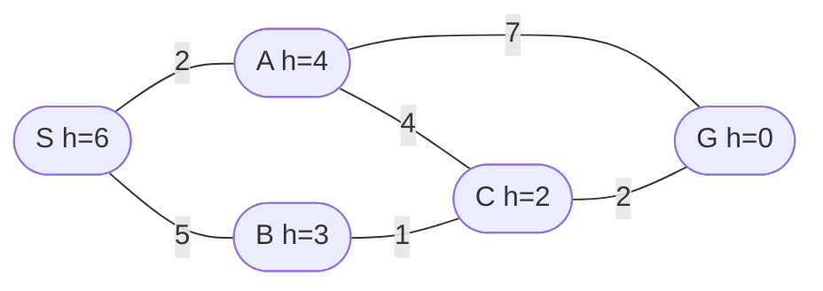

# Q2 — Consistent vs. Admissible Heuristics; A* vs. Greedy Best-First

> Topics: heuristic properties, A*, greedy best-first search · Handnote pp. 7–11

## Question

*"A consistent heuristic is always admissible, but not vice versa" — justify this statement.* A delivery robot moves on a weighted graph:

```text
Edges (cost, two-way): S–A (2), S–B (5), A–C (4), B–C (1), A–G (7), C–G (2)
Heuristic:             h(S)=6, h(A)=4, h(B)=3, h(C)=2, h(G)=0
```



1. Trace A* from S to G (open list with f = g + h, closed list), and report the optimal path and cost.
2. Verify whether h is admissible and whether it is consistent along every edge.
3. Trace greedy best-first search (by h alone). Does it find the optimal path? Explain the difference between what A* and GBFS optimize.

## Definitions

- **Admissible:** `h(n) ≤ h*(n)` for every n (never overestimates the true remaining cost).
- **Consistent:** `h(u) ≤ c(u, v) + h(v)` for every edge u → v, and `h(goal) = 0` (a triangle inequality).

## Proof: consistent ⇒ admissible

Take any node n with an optimal path `n = v0 → v1 → … → vk = G`, so `h*(n) = Σ c(vi, vi+1)`. Applying consistency along each edge and chaining the inequalities:

```text
h(v0) ≤ c(v0,v1) + h(v1)
      ≤ c(v0,v1) + c(v1,v2) + h(v2)
      ≤ …
      ≤ Σ_i c(vi, vi+1) + h(G) = h*(n) + 0
```

So `h(n) ≤ h*(n)`: h is admissible. (If no goal is reachable from n, h*(n) = ∞ and the claim holds trivially.)

**The converse fails (counterexample).** Take A → B (cost 1), B → G (cost 10), with h(A) = 10 and h(B) = 1. Then h*(A) = 11 and h*(B) = 10, so 10 ≤ 11 and 1 ≤ 10: h is **admissible**. But on edge A → B, `h(A) = 10 > c(A,B) + h(B) = 1 + 1 = 2`: h is **not consistent**.

---

## Step 0: true costs h* (needed for part ii)

Computed backward from G:

```text
h*(G) = 0
h*(C) = 2                          (C → G)
h*(B) = 1 + 2 = 3                  (B → C → G)
h*(A) = min(7, 4 + 2) = 6          (A → C → G)
h*(S) = min(2 + 6, 5 + 3) = 8      (both routes cost 8)
```

## (i) A* trace

f = g + h; ties broken by smaller h.

| Step | Expand | New / updated nodes | OPEN after (by f) | CLOSED |
|---:|---|---|---|---|
| 0 | — | S: g 0, h 6, f 6 | S(6) | { } |
| 1 | S (f 6) | A: g 2, f 2+4 = 6 · B: g 5, f 5+3 = 8 | A(6), B(8) | {S} |
| 2 | A (f 6) | C: g 2+4 = 6, f 6+2 = 8 · G: g 2+7 = 9, f 9 | C(8), B(8), G(9) | {S, A} |
| 3 | C (f 8) | G: g 6+2 = 8 < 9 → update G to f 8 (parent C) | G(8), B(8) | {S, A, C} |
| 4 | G (f 8) | goal test succeeds | B(8) | {S, A, C, G} |

**Answer:** optimal path **S → A → C → G**, cost 2 + 4 + 2 = **8**. (If ties are broken FIFO instead, A* expands B at step 3; B reaches C with g = 6, which is no improvement, and the result is the same cost 8. S → B → C → G also costs 8.)

## (ii) Admissibility and consistency

**Admissibility:** h(n) ≤ h*(n)

| Node | h | h* | Check |
|---|---:|---:|:---:|
| S | 6 | 8 | 6 ≤ 8 ✓ |
| A | 4 | 6 | 4 ≤ 6 ✓ |
| B | 3 | 3 | 3 ≤ 3 ✓ (exact) |
| C | 2 | 2 | 2 ≤ 2 ✓ (exact) |
| G | 0 | 0 | 0 ≤ 0 ✓ |

**Consistency:** h(u) ≤ c(u, v) + h(v), checked in both directions because the roads are two-way.

| Edge | c | Check | | Edge | c | Check | |
|---|---:|---|:---:|---|---:|---|:---:|
| S → A | 2 | 6 ≤ 2 + 4 = 6 | ✓ (tight) | A → S | 2 | 4 ≤ 2 + 6 = 8 | ✓ |
| S → B | 5 | 6 ≤ 5 + 3 = 8 | ✓ | B → S | 5 | 3 ≤ 5 + 6 = 11 | ✓ |
| A → C | 4 | 4 ≤ 4 + 2 = 6 | ✓ | C → A | 4 | 2 ≤ 4 + 4 = 8 | ✓ |
| A → G | 7 | 4 ≤ 7 + 0 = 7 | ✓ | G → A | 7 | 0 ≤ 7 + 4 = 11 | ✓ |
| B → C | 1 | 3 ≤ 1 + 2 = 3 | ✓ (tight) | C → B | 1 | 2 ≤ 1 + 3 = 4 | ✓ |
| C → G | 2 | 2 ≤ 2 + 0 = 2 | ✓ (tight) | G → C | 2 | 0 ≤ 2 + 2 = 4 | ✓ |

**Answer:** all 12 checks hold and h(G) = 0, so h is **consistent**, and therefore also **admissible**.

## (iii) Greedy best-first trace (f = h)

| Step | Expand | OPEN after (by h) | CLOSED |
|---:|---|---|---|
| 0 | — | S(6) | { } |
| 1 | S | B(3), A(4) | {S} |
| 2 | B | C(2), A(4) | {S, B} |
| 3 | C | G(0), A(4) | {S, B, C} |
| 4 | G | goal | {S, B, C, G} |

**Answer:** GBFS finds S → B → C → G, cost 5 + 1 + 2 = **8**. This is optimal here **only by chance**, because both routes cost 8. GBFS is not optimal in general: if B–C cost 4 instead (h(B) = 3 is still admissible), GBFS would still take S → B → C → G at cost 11, while A* finds S → A → C → G at cost 8.

### What each algorithm optimizes

- **A\*** ranks nodes by `f(n) = g(n) + h(n)`, the estimated cost of the whole solution through n. It balances the cost already paid against the estimated cost still to pay, and with an admissible h it is optimal.
- **GBFS** ranks nodes by `h(n)` alone, i.e. how close n looks to the goal. It ignores the cost already paid, so it is often fast but not optimal, and misleading h values can lead it astray.
