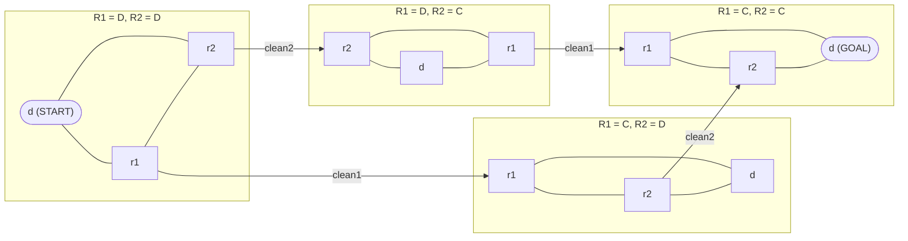

# Q4 — Abstraction Heuristics: Identity vs. Perfect; Orthogonal Abstractions

> Topics: abstractions, projections (pattern databases), orthogonality, cost partitioning · Handnote pp. 16–20

## Question

*Distinguish between identity abstraction and perfect abstraction.* A cleaning robot has three state variables:

```text
L  = robot-location ∈ {dock (d), room1 (r1), room2 (r2)}
R1 = room1-status   ∈ {dirty (D), clean (C)}
R2 = room2-status   ∈ {dirty (D), clean (C)}

Initial: robot at dock, both rooms dirty      →  (d, D, D)
Goal:    both rooms clean, robot back at dock →  (d, C, C)

Actions (cost 1): move between any two of d, r1, r2 (6 moves)
                  clean1 (pre: L = r1; effect: R1 := C)
                  clean2 (pre: L = r2; effect: R2 := C)
```

1. Draw the complete concrete transition system over all reachable states, and find the optimal solution cost.
2. Find two orthogonal abstractions (e.g., one dropping room2-status, one dropping room1-status), compute each abstract solution cost, combine them admissibly by summation, and compare with the true cost.

## Background

An abstraction α maps each concrete state to an abstract state. The heuristic `h^α(s)` is the cheapest abstract path from α(s) to an abstract goal. It is always **admissible and consistent**, because every concrete path maps to an abstract path of the same cost. Abstract paths that have no concrete counterpart (**spurious paths**) are why h^α can underestimate.

A useful abstraction must be both **informative** (close to h*) and **cheap to compute**. Two extremes illustrate the trade-off:

| | Identity abstraction | Perfect abstraction |
|---|---|---|
| Mapping | α(s) = s | any α with h^α = h*, e.g. α(s) = h*(s) |
| Information lost | None | Only what does not affect the cost to the goal |
| Heuristic | Exact: h^α = h* | Exact: h^α = h* |
| Abstract size | Same as the concrete space (huge) | Can be very small |
| Problem | No reduction: computing it means solving the task | Building it requires knowing h* already |

The other extreme, the **one-state abstraction** (every state maps to one abstract state), gives h^α = 0 and is useless. Practical methods sit in between: **pattern databases** (projections onto a subset of variables, with all abstract goal distances precomputed) and **merge-and-shrink**.

---

## (i) Concrete transition system

All 3 × 2 × 2 = **12 states** are reachable. Group them by the room statuses (R1, R2); within each group the robot can move freely among d, r1 and r2.



- **Transitions:** 12 states × 2 moves each = 24 move transitions, plus 2 `clean1` and 2 `clean2` transitions that change a status (cleaning an already clean room is a self-loop and is omitted).
- **Optimal plan:** `move(d, r1) → clean1 → move(r1, r2) → clean2 → move(r2, d)`, so **h\*(I) = 5**.
- **Why 5 is minimal:** two cleans are needed, and the robot must visit r1 and r2 and return to d, which takes at least 3 moves (d → r1 → r2 → d or the reverse). 2 + 3 = 5.

## (ii) Two abstractions and their combination

**α1 = projection onto {L, R1}** (drops room2-status). Abstract init (d, D), goal (d, C):

```text
move(d, r1) → clean1 → move(r1, d)        h^α1(I) = 3
```

**Literal reading: projection onto {L, R2}** (drops room1-status). By symmetry:

```text
move(d, r2) → clean2 → move(r2, d)        h(I) = 3
```

### When can abstraction heuristics be added?

An abstraction α is **affected** by action a if a causes a non-self-loop transition in α's abstract system. Two abstractions are **orthogonal** if no action affects both; then `h^α1 + h^α2` is admissible and consistent.

**Check {L, R1} with {L, R2}:** every move changes L, and both projections keep L, so the moves affect both. This pair is **not orthogonal**, and summing gives 3 + 3 = 6 > h* = 5, which is **inadmissible**: the moves are counted twice.

**Make the pair orthogonal** by also dropping L from the second projection: **α2 = projection onto {R2}**.

```text
Active(α1) = {all 6 moves, clean1}
Active(α2) = {clean2}
Active(α1) ∩ Active(α2) = ∅   →  orthogonal ✓

h^α2(I): D --clean2--> C        cost 1   (location ignored, so clean2 is always applicable)
```

**Combined estimate:**

```text
h_sum(I) = h^α1(I) + h^α2(I) = 3 + 1 = 4 ≤ h*(I) = 5     → admissible, underestimates by 1
```

The gap of 1 arises because α2 does not see the trip into room2 and back, and α1 does not need `move(r1, r2)`.

**Alternative: cost partitioning.** Keep {L, R1} and {L, R2}, but give each move action half its cost in each abstraction (so the costs still sum to the original). Then each abstraction gives 0.5 + 1 + 0.5 = 2, and the sum is 2 + 2 = 4, also admissible.

## Answer

- **Identity abstraction** α(s) = s loses no information, so h^α = h*, but the abstract space is as large as the concrete one and nothing is gained. A **perfect abstraction** also gives h^α = h* and can be tiny (e.g. α(s) = h*(s)), but building it requires knowing h*, i.e. solving the task.
- **(i)** 12 reachable states; optimal plan move(d, r1), clean1, move(r1, r2), clean2, move(r2, d); **h\*(I) = 5**.
- **(ii)** h^{L,R1}(I) = 3 and h^{L,R2}(I) = 3, but these two share the move actions, so their sum 6 > 5 is inadmissible. With the orthogonal pair {L, R1} and {R2}: 3 + 1 = **4 ≤ 5**, an admissible estimate that underestimates h* by 1.
