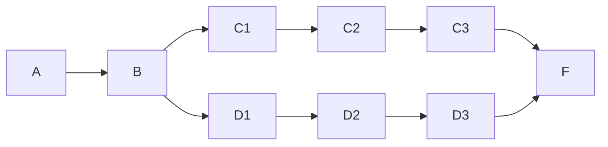

# Q7 — Landmark Heuristics: Fact Landmarks, Disjunctive Action Landmarks, LM-Cut

> Topics: fact landmarks, necessary subgoals, disjunctive action landmarks, LM-cut, cost partitioning · Handnote pp. 30–35

## Question

*What is a fact landmark? What are the fact landmarks and necessary subgoals for the initial state of the following path-finding problem?* Actions `move(X, Y)`: pre X, effect Y. Init A, goal F.



1. Show why naive fact-landmark extraction fails: neither the C-branch nor the D-branch facts are landmarks individually, even though one branch must be used.
2. Explain how fact-induced disjunctive action landmarks rescue the problem. Extract them using (a) delete relaxation and (b) LM-cut.
3. Explain how to combine the disjunctive action landmarks admissibly into one heuristic estimate.

(Whether moves go only left to right or both ways along the drawn edges, every result below is the same.)

## Definitions

For an FDR task `Π = ⟨V, A, c, I, G⟩` and state s:

- **Fact landmark:** a fact p is a landmark for s if for every plan `⟨a1, …, an⟩` for s there is a prefix length t with `p ∈ s⟦a1, …, at⟧`. In words: p becomes true at some point in every plan. It is **non-trivial** if p ∉ s.
- **Disjunctive action landmark:** a set L ⊆ A such that every plan for s contains at least one action from L.
- **Necessary subgoals (backchaining):** (1) every goal fact p ∉ s is a landmark; (2) if p is a landmark and all achievers of p share a precondition q ∉ s, then q is also a landmark: `q ∈ ∩_{a : p ∈ eff(a)} pre(a)`.

## Fact landmarks and necessary subgoals for I = {A}

- **Fact landmarks = {B, F}** (non-trivial). A is a trivial landmark, since it already holds in I. Every route from A must pass through B, and every plan ends with F true.
- **Necessary subgoals:** start from F (the goal). Its achievers are `move(C3, F)` with pre {C3} and `move(D3, F)` with pre {D3}. Since {C3} ∩ {D3} = ∅, backchaining stops. **Necessary subgoals = {F}.**
- B is a landmark, but backchaining cannot find it, because the chain breaks at F. Delete-relaxation methods (below) are needed.

---

## (i) Why naive fact-landmark extraction fails

There are two alternative routes from B to F:

```text
C-plan:  A → B → C1 → C2 → C3 → F
D-plan:  A → B → D1 → D2 → D3 → F
```

The C-plan never makes D1, D2 or D3 true, so no D-fact is a landmark; the D-plan never makes C1, C2 or C3 true, so no C-fact is a landmark. Only {B, F} survive, and counting them gives **h(I) = 2 while h\*(I) = 5**. The missing knowledge, such as "C1 *or* D1 must be reached", is **disjunctive**, and single facts cannot express it.

## (ii-a) Disjunctive action landmarks via delete relaxation

**Idea:** work in the relaxed task Π⁺, where deletes are ignored. A fact p is a landmark if Π⁺ becomes unsolvable after removing all achievers of p. A set L of actions is a disjunctive action landmark if Π⁺ becomes unsolvable after removing L.

**Fixed-point equations** (LM(p) = facts that must hold before or when p first holds):

```text
LM(p) = {p}                                              if p ∈ I
LM(p) = {p} ∪ ∩_{a : p ∈ add(a)} ∪_{q ∈ pre(a)} LM(q)    otherwise
```

| Fact | Achievers | LM(fact) |
|---|---|---|
| A | (initial) | {A} |
| B | move(A,B) | {B} ∪ LM(A) = {A, B} |
| C1, C2, C3 | move(B,C1), move(C1,C2), move(C2,C3) | {A,B,C1}, {A,B,C1,C2}, {A,B,C1,C2,C3} |
| D1, D2, D3 | move(B,D1), move(D1,D2), move(D2,D3) | {A,B,D1}, {A,B,D1,D2}, {A,B,D1,D2,D3} |
| F | move(C3,F), move(D3,F) | {F} ∪ (LM(C3) ∩ LM(D3)) = **{A, B, F}** |

So the fact landmarks are {A, B, F}, and the non-trivial ones are {B, F}. Converting them to action landmarks, and adding every cut whose removal makes F relaxed-unreachable:

```text
L0 = {move(A,B)}                     achievers of landmark B
L1 = {move(B,C1), move(B,D1)}        removing both makes F unreachable
L2 = {move(C1,C2), move(D1,D2)}
L3 = {move(C2,C3), move(D2,D3)}
L4 = {move(C3,F), move(D3,F)}        achievers of landmark F
```

## (ii-b) Disjunctive action landmarks via LM-cut (unit costs)

**LM-cut loop:**

1. Compute h^max; stop if h^max(goal) = 0.
2. Each action selects its precondition with the highest h^max (here every action has one precondition).
3. The **goal zone** is the set of facts that reach the goal through 0-cost actions.
4. The **cut** is the set of actions leading from outside the goal zone into it; it is a landmark L.
5. Add m = min cost in L to h, subtract m from every action in L, and repeat.

h^max in round 1: A = 0, B = 1, C1 = D1 = 2, C2 = D2 = 3, C3 = D3 = 4, F = 5.

| Round | h^max(F) | Goal zone | Cut (landmark) | Cost m |
|---:|---:|---|---|---:|
| 1 | 5 | {F} | L4 = {move(C3,F), move(D3,F)} | 1 |
| 2 | 4 | {F, C3, D3} | L3 = {move(C2,C3), move(D2,D3)} | 1 |
| 3 | 3 | {F, C3, D3, C2, D2} | L2 = {move(C1,C2), move(D1,D2)} | 1 |
| 4 | 2 | … ∪ {C1, D1} | L1 = {move(B,C1), move(B,D1)} | 1 |
| 5 | 1 | … ∪ {B} | L0 = {move(A,B)} | 1 |
| 6 | 0 | stop | | |

```text
h^LM-cut(I) = 1 + 1 + 1 + 1 + 1 = 5
```

LM-cut finds the same five landmarks, but from the goal backwards (L4 first). Here they are pairwise disjoint: every action in each cut costs exactly m = 1, drops to 0, and can never be cut again. (In general LM-cut landmarks can overlap when an action costs more than m; they remain jointly admissible because subtracting m after each cut is a cost partitioning.)

## (iii) Combining landmarks admissibly

**Single landmark:** `h_L(s) = min_{a ∈ L} c(a)` is admissible, since every plan pays for at least one action of L.

**Why simple counting can overcount:** one action can belong to several landmarks, and summing then pays for that action more than once. Example: `L5 = {move(B,C1), move(D3,F)}` is also a valid landmark, because every C-plan uses move(B,C1) and every D-plan uses move(D3,F). Summing L0, …, L5 gives **6 > h\* = 5**, which is **inadmissible**: the C-plan pays for move(B,C1) once, but it is counted in both L1 and L5.

**Fixes:**

- **Disjoint landmarks** (canonical heuristic): only sum landmarks that share no action (Li ∩ Lj = ∅), and take the max over such disjoint collections.
- **Cost partitioning:** split each action's cost among the landmarks containing it so that `Σ_i c_i(a) ≤ c(a)`. Then `h = Σ_i min_{a ∈ Li} c_i(a)` is admissible (uniform or optimal LP cost partitioning). LM-cut does this automatically by reducing costs after each cut.

**Here:** L0, …, L4 are pairwise disjoint (each action appears in exactly one landmark), so each landmark can use the full action cost:

```text
h(I) = Σ_{i=0..4} min_{a ∈ Li} c(a) = 1 + 1 + 1 + 1 + 1 = 5 = h*(I)     (also = h⁺(I) = 5)
```

## Answer

- **Fact landmark:** a fact p that becomes true at some point in every plan from s (non-trivial if p ∉ s). For I = {A}: **fact landmarks {B, F}** (A is trivial); **necessary subgoals {F}** only, because the achievers of F have preconditions {C3} and {D3}, which share nothing.
- **(i)** The C-route never visits D1–D3 and the D-route never visits C1–C3, so no single branch fact is a landmark. Only {B, F} remain: h = 2 ≪ h* = 5. The needed knowledge is disjunctive ("C1 or D1").
- **(ii)** (a) Delete relaxation: LM(F) = {F} ∪ (LM(C3) ∩ LM(D3)) = {A, B, F}; achiever sets and relaxed cuts give L0 = {move(A,B)}, L1 = {move(B,C1), move(B,D1)}, L2 = {move(C1,C2), move(D1,D2)}, L3 = {move(C2,C3), move(D2,D3)}, L4 = {move(C3,F), move(D3,F)}. (b) LM-cut: h^max(F) = 5, then cuts L4, L3, L2, L1, L0, each of cost 1, until h^max = 0: **h^LM-cut(I) = 5**.
- **(iii)** h_L = min_{a ∈ L} c(a). Summing overlapping landmarks double-counts shared actions (adding L5 gives 6 > 5). An admissible combination needs pairwise disjoint landmarks or a cost partitioning with Σ_i c_i(a) ≤ c(a). L0–L4 are disjoint, so h = 5 = h*(I).
